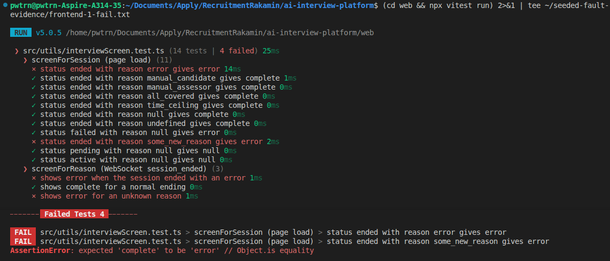
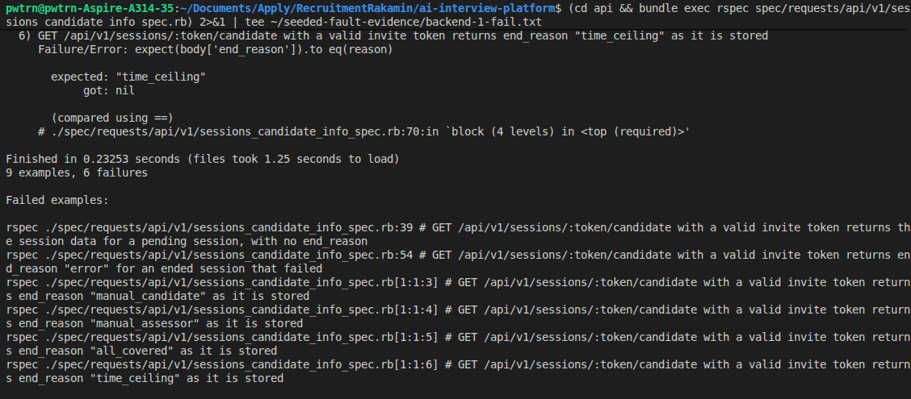
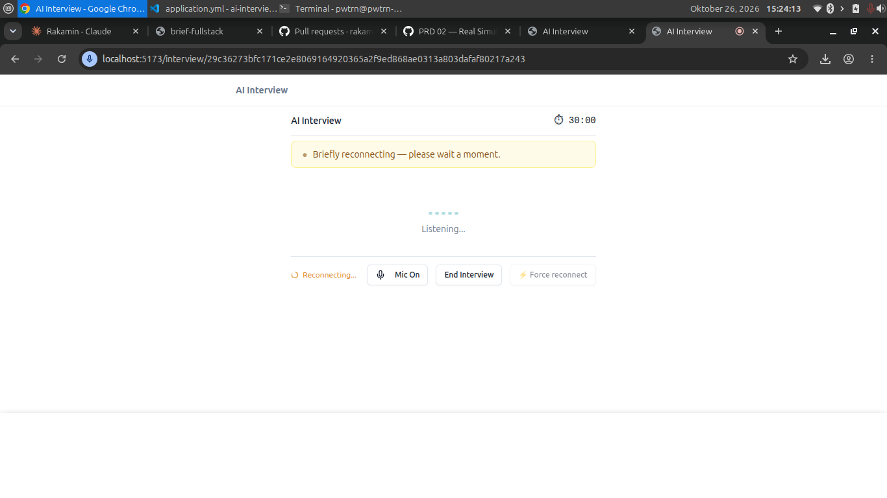
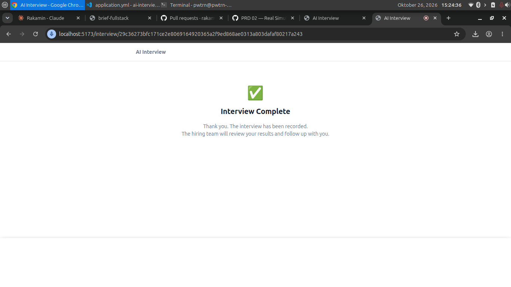
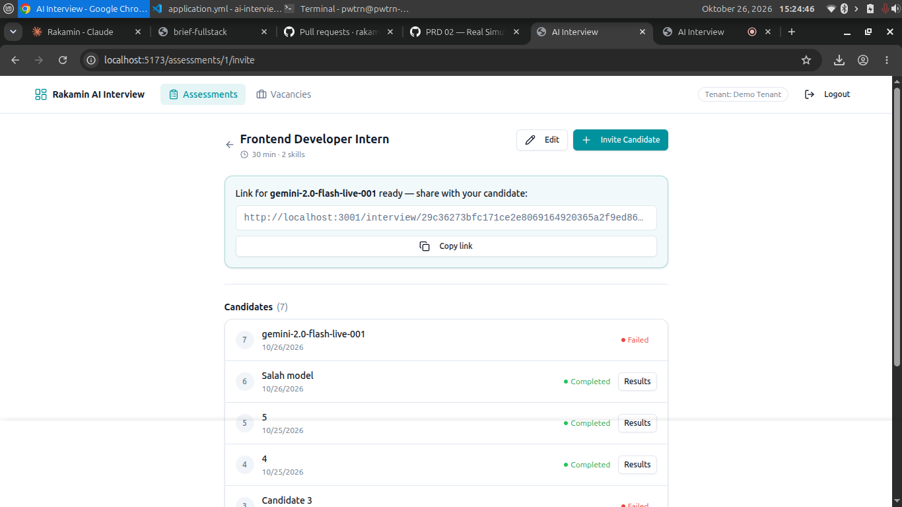
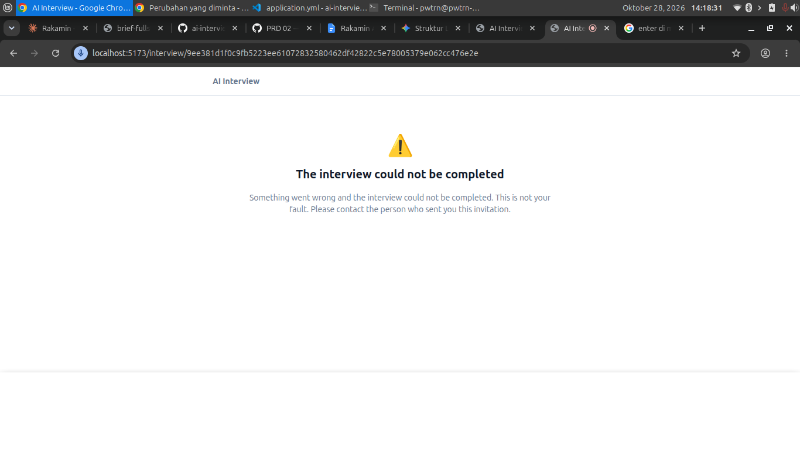
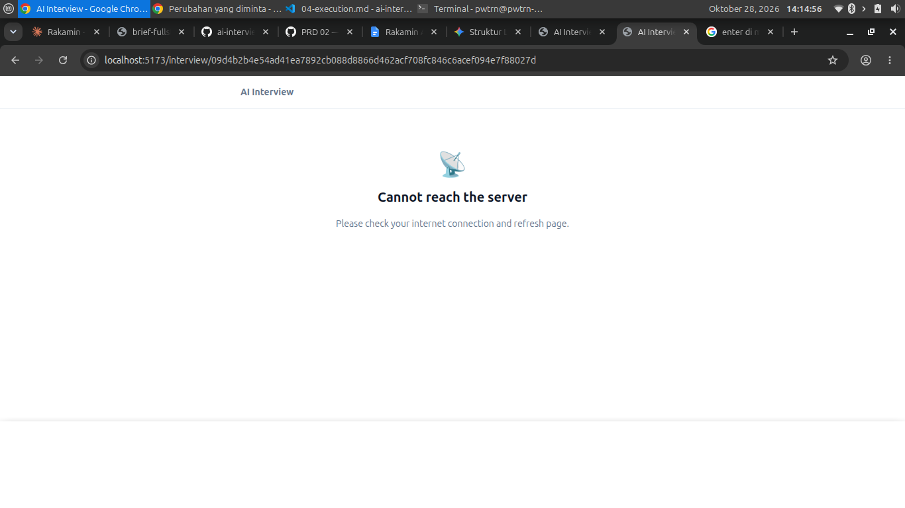
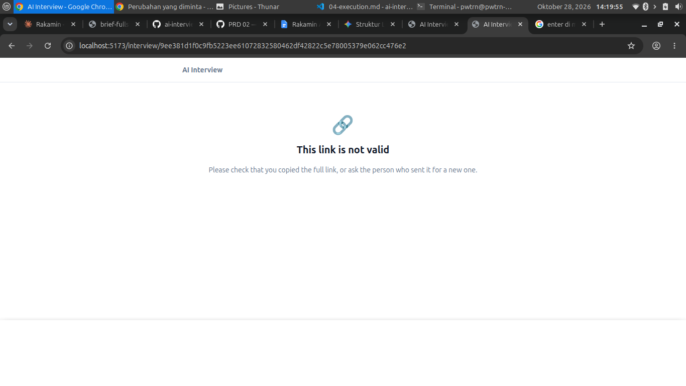

# 04. Bukti eksekusi

## 1. Yang diubah

| Lapisan | File                                                  | Perubahan                                                                                                                     |
| ------- | ----------------------------------------------------- | ----------------------------------------------------------------------------------------------------------------------------- |
| api     | `sessions_controller.rb`                              | `candidate_info` ikut mengembalikan `end_reason`                                                                              |
| web     | `utils/interviewScreen.ts` baru, dan `types/index.ts` | Fungsi `screenForReason` dan `screenForSession`, serta tipe dan state baru                                                    |
| web     | `hooks/useAudioWebSocket.ts`                          | Alasan dari `session_ended` dipetakan ke layar, koneksi putus menjadi `connection_lost`                                       |
| web     | `pages/interview/InterviewPage.tsx`                   | Layar ditentukan dari status dan alasan, layar baru untuk error, link tidak valid, server tidak terjangkau, dan koneksi putus |

## 2. Tes

Persiapan: RSpec terpasang, Vitest terpasang dan skrip `test` ada di package.json. Perintah: `bundle exec rspec` di `api/` dan `npm test` di `web/`.

| Kriteria           | Tes                                                                                 | Lapisan | Jenis    | Hasil         |
| ------------------ | ----------------------------------------------------------------------------------- | ------- | -------- | ------------- |
| AC-12              | `candidate_info` untuk sesi `ended` dengan `error`, sesi `pending`, dan token salah | api     | Otomatis | Lulus, 9 tes  |
| AC-01 sampai AC-04 | `screenForSession`                                                                  | web     | Otomatis | Lulus, 11 tes |
| AC-07 dan AC-08    | `screenForReason`                                                                   | web     | Otomatis | Lulus, 3 tes  |
| AC-07              | Nama model palsu, buka link tanpa memuat ulang, hasilnya layar error                | web     | Manual   | Lulus         |
| AC-05              | Ubah satu huruf token, hasilnya "This link is not valid"                            | web     | Manual   | Lulus         |
| AC-06              | Matikan backend lalu buka link, hasilnya "Cannot reach the server"                  | web     | Manual   | Lulus         |
| AC-09 dan AC-13    | Matikan backend saat wawancara, hasilnya banner reconnecting lalu "Connection lost" | web     | Manual   | Lulus         |
| AC-08              | Tombol End menghasilkan layar selesai, bukan "Connection lost"                      | web     | Manual   | Lulus         |

Hook WebSocket dan halaman belum punya tes otomatis, jadi saya mengujinya manual.

Keluaran tes terakhir: \
web:\
✓ src/utils/interviewScreen.test.ts (14 tests) 16ms \
✓ screenForSession (page load) (11)\
✓ status ended with reason error gives error 5ms\
✓ status ended with reason manual_candidate gives complete 1ms\
✓ status ended with reason manual_assessor gives complete 0ms\
✓ status ended with reason all_covered gives complete 1ms\
✓ status ended with reason time_ceiling gives complete 1ms\
✓ status ended with reason null gives complete 0ms\
✓ status ended with reason undefined gives complete 0ms\
✓ status failed with reason null gives error 0ms\
✓ status ended with reason some_new_reason gives error 0ms\
✓ status pending with reason null gives null 1ms\
✓ status active with reason null gives null 0ms\
✓ screenForReason (WebSocket session_ended) (3)\
✓ shows error when the session ended with an error 0ms\
✓ shows complete for a normal ending 0ms\
✓ shows error for an unknown reason 0ms

Test Files 1 passed (1)\
Tests 14 passed (14)\
Start at 13:46:12\
Duration 604ms (transform 39%, import 32%, tests 19%, worker 10%)

PASS Waiting for file changes...\
press h to show help, press q to quit

api:\
.........\

Finished in 0.21216 seconds (files took 1.37 seconds to load)\
9 examples, 0 failures

## 3. Seeded fault test

Dari branch perbaikan, saya membuat branch `scratch/seeded-fault`, merusak logika dengan sengaja, menjalankan tes, lalu mengembalikannya dengan `git revert` agar riwayat terlihat.

| Sisi | Kerusakan                                                                           | Tes yang gagal                                                                                                                                                               | Commit rusak | Commit kembali |
| ---- | ----------------------------------------------------------------------------------- | ---------------------------------------------------------------------------------------------------------------------------------------------------------------------------- | ------------ | -------------- |
| web  | `screenForReason` selalu mengembalikan `"complete"`. Ini mereproduksi bug asli T-1. | 4 dari 14: `ended` + `error`, `ended` + alasan tak dikenal, `session_ended` dengan `error`, dan `session_ended` dengan alasan tak dikenal. Setelah revert, 14 dari 14 lulus. | `aca14f5`    | `1135314`      |
| api  | Hapus baris `end_reason:` di `candidate_info` pada controller.                      | 6 dari 9: sesi `pending`, `error`, `manual_candidate`, `manual_assessor`, `all_covered`, dan `time_ceiling`. Setelah revert, 9 dari 9 lulus.                                 | `baea47a`    | `951e783`      |

Tiga spec api yang tetap lulus saat kerusakan (status `failed`, tanpa header Authorization, dan token tidak dikenal) memang tidak memeriksa `end_reason`.

## 4. Momen verifikasi AI

**Saran backend yang tidak perlu.** AI menyebut backend mungkin perlu menambah alasan pada `session_ended`. Saya membaca `handle_gemini_close` di middleware dan menemukan alasan itu sudah dikirim. Bug-nya ada di hook frontend yang membuangnya.

## 5. Screenshot

Sebelum perbaikan:\
Reconnecting sebelum attempt habis

Setelah attempt habis

Status di dashboard asesor failed meskipun di screenshot sebelumnya tertera complete

Setelah perbaikan:\
Model tidak tersedia

Server sengaja dimatikan

Token/url tidak valid

